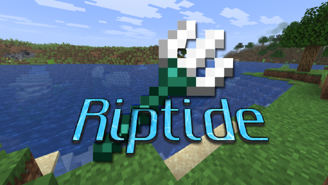

# Riptide



A **Minecraft client** written **from scratch** in **modern C++**.

## Warning

The project is currently **under heavy development**! As it is very young, there are a lot of features missing. I am currently targeting **Minecraft Java Edition 1.8.9 server** compatibility.

## Documentation

Documentation is available [here](/docs).

## How to help me?

* [Try the client](#build-and-run)
* [Report a bug](https://github.com/wither16x/riptide/issues)
* [Contribute](/CONTRIBUTING.md)

## Build and run

Make sure that the following dependencies are installed on your system:
* The LLVM 24 toolchain with libc++ and clang++
* The CMake build system version 4.4
* Java (for running the test server)

To build the code, run the following commands at the root of the project.

```sh
cmake -S . -B build -G Ninja -DCMAKE_CXX_COMPILER="clang++"
cmake --build build
```

An executable should have been generated at `build/riptide/client/riptide_client`. You can run it directly.

## Running the test server

The test server directory is located at [here](/server). You need to download a `server.jar` file for Minecraft Java Edition 1.8.9. You can get it from your launcher.  
Next, run

```sh
java -jar server/server.jar
```

Do not forget to accept the EULA in `server/eula.txt`: just set `eula` to `true`.